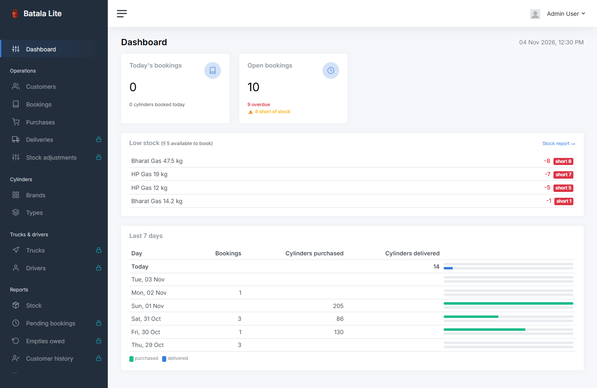
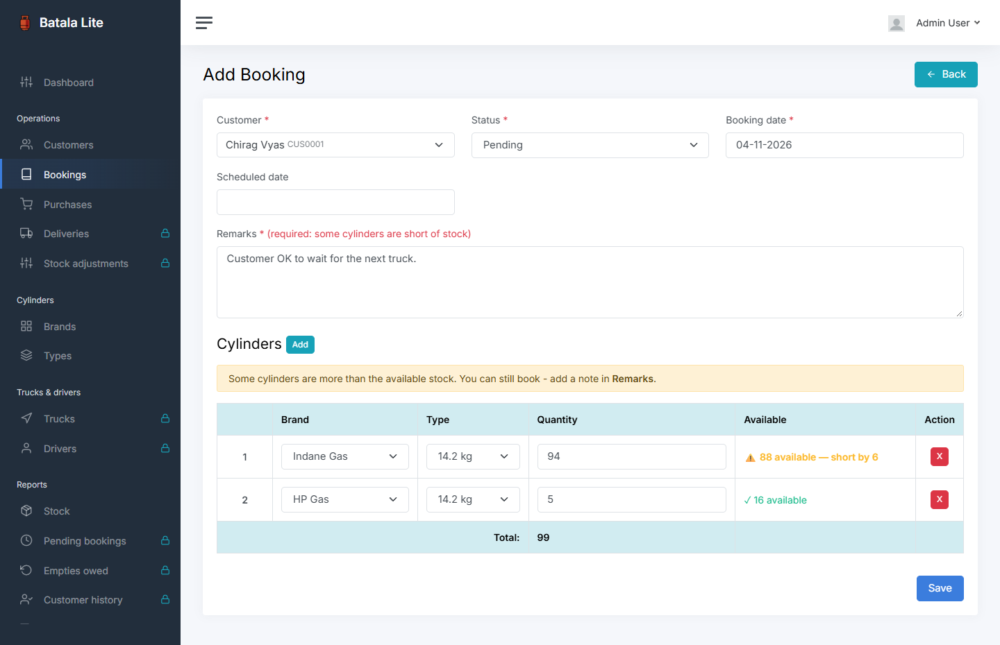
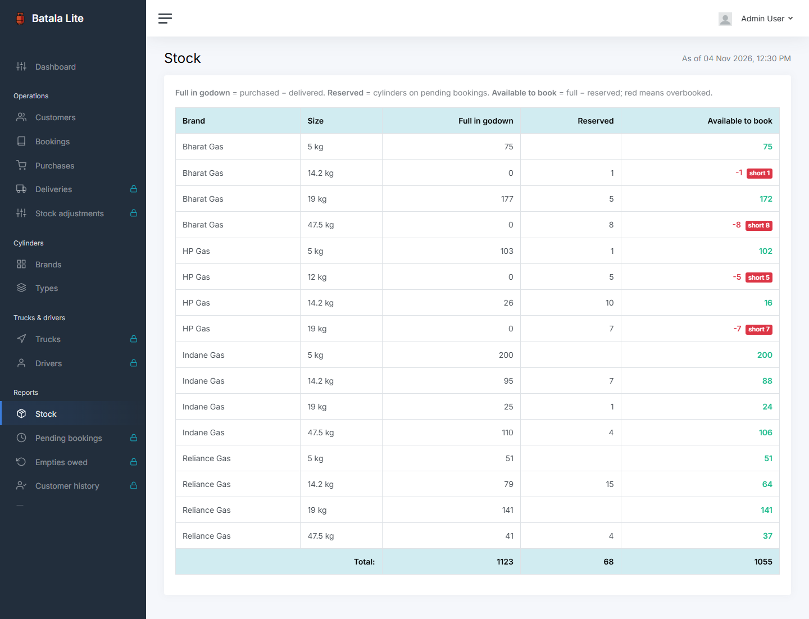
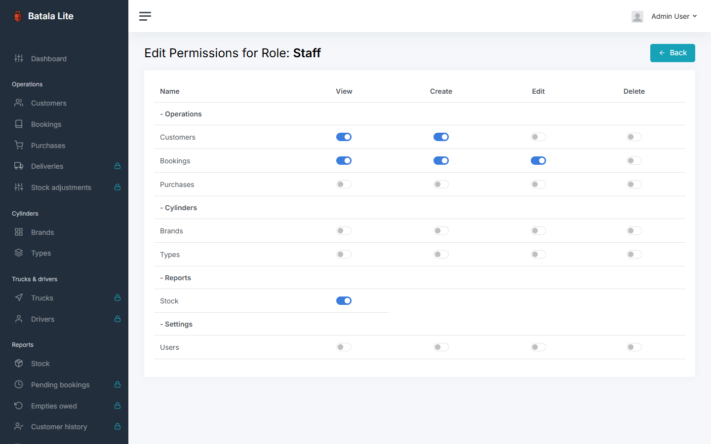
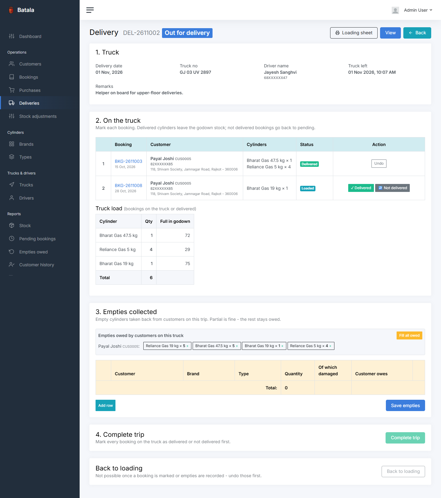
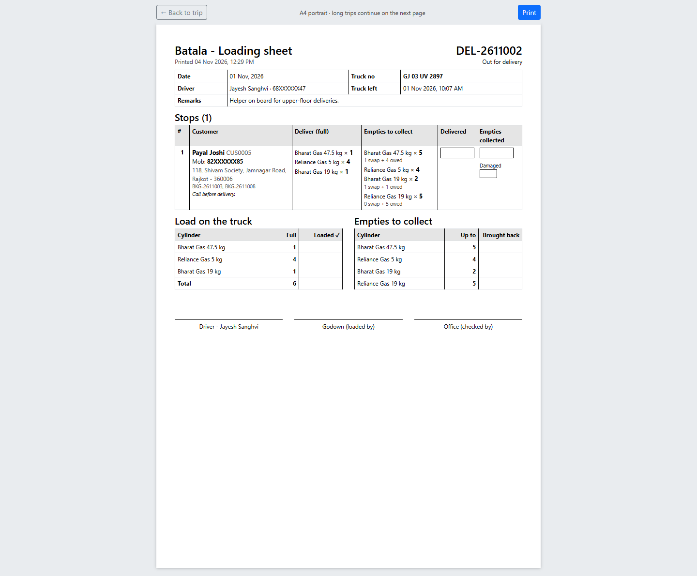
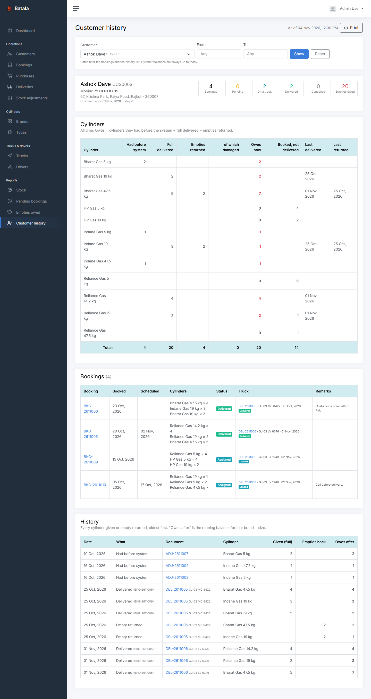
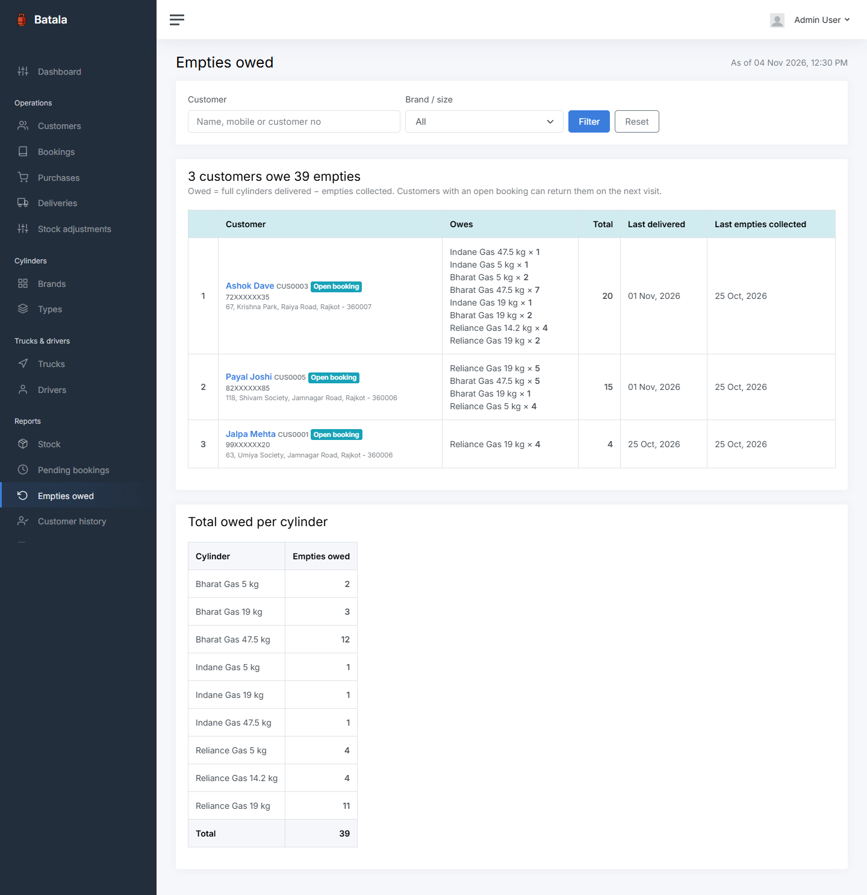

<p align="center">
    
</p>

<h1 align="center">Batala Lite</h1>

<p align="center"><strong>LPG cylinder distributor back-office</strong> - customers, bookings with a live stock check, purchases, stock report, roles &amp; permissions.</p>

<p align="center">
    
    
    
    
</p>

*Batala* (બાટલા) is the everyday Gujarati word for gas cylinders.

This is the **public lite version**. The full version - delivery trips, empties tracking, stock adjustments and more reports - is private; its modules are still in the menu with a 🔒 and open a preview page with screenshots ([see below](#full-version)). Live demo on request.

## Screenshots

All names, mobile numbers, addresses and truck numbers in the screenshots are fake, generated by `app:fake-data`, and mobile numbers are masked (`98XXXXXX47`). Any match with a real person is a coincidence.

| Dashboard | Booking - beyond available stock |
|---|---|
|  |  |
| **Stock report** | **Role permissions** |
|  |  |

## Features

| Module | What it does |
|---|---|
| **Login & profile** | Login, forgot / reset password, profile, change password. No public registration. |
| **Users & roles** | 4 roles: admin › owner › sub owner › staff. Admin / owner tick per-menu permissions for the lower roles. Menu, permissions and page titles come from one config file. |
| **Customers** | Add / edit / delete, server-side search table, one customer per mobile number (live duplicate check while typing), English-only name validation. |
| **Cylinder brands & types** | Brands with logo; sizes per brand (e.g. 14.2 kg domestic, 19 kg commercial). |
| **Bookings** | Customer + brand + size + quantity. The form shows **available stock** per row. Booking beyond it is allowed but flagged **short stock** and needs a remark. Status: pending → delivered / cancelled. **Mark delivered** takes the cylinders out of stock and locks the booking. |
| **Purchases** | Stock in from the company truck: full cylinders received, truck number + driver typed on the form (earlier ones are suggested; a truck remembers its last driver). |
| **Stock report** | Per brand + size: full in godown, reserved by pending bookings, available to book. |
| **Dashboard** | Today's bookings, open / overdue / short-stock bookings, low stock, last 7 days (bookings, purchased, delivered). |
| **Full version 🔒** | Locked menu items open a preview page: what the module does + screenshots from the full version. |

## How stock works

1. A **purchase** adds full cylinders to the godown.
2. A **pending booking** reserves cylinders - they are still in the godown, but promised.
3. **Mark delivered** takes them out of the godown and ends the reservation.
4. **Available to book** = full in godown − reserved. Bookings are flagged short stock first come, first served (by booking date), and the flags update after every booking, purchase or delivery.

## Architecture

- **Stock as signed movements:** every quantity is a row in `stock_movements` with a morph `source` (purchase or booking), brand, size and a signed quantity; `StockMovementType` decides the sign and whether a row counts in the godown (a booking row is a reservation, not stock).
- **One place to read stock:** `App\Services\StockService` (`godown`, `reserved`, `available`, `refreshShortStock`); writes go through the `HasStockMovements` trait. `BookingService::markDelivered()` locks the booking row and re-checks it inside the transaction, so a double click can't take stock out twice.
- **Config-driven menu and permissions:** `config/permissions.php` defines the sidebar, page titles and permissions (spatie/laravel-permission); `app:seed-permissions` syncs it to the database. Locked full-version modules live in the same file.
- **Form Requests + policies** for every module; line-item forms (bookings, purchases) share one validation trait.
- **`BaseDataTable`** for the server-side tables (yajra/laravel-datatables); **`HasUserTracking`** fills `created_by` / `updated_by` / `deleted_by`; soft deletes on domain models.
- **No build step:** AdminKit 3.4 (Bootstrap 5), jQuery, DataTables, Tom Select, Flatpickr and SweetAlert2 are prebuilt in `public/assets/`.

## Getting started

Needs PHP 8.2+, Composer and MySQL (no Node / npm).

```bash
composer install
cp .env.example .env              # set DB_DATABASE / DB_USERNAME / DB_PASSWORD
php artisan key:generate
php artisan migrate:fresh --seed  # tables, roles, demo users, cylinder brands & sizes, permissions
php artisan app:fake-data         # optional: fake customers, purchases, bookings (local only)
php artisan storage:link          # brand logos
php artisan serve                 # http://127.0.0.1:8000
```

`app:fake-data` adds on top of what exists and refuses to run in production. Options: `--customers= --purchases= --bookings= --delivered=`.

Optional for a demo: `ADMIN_USERNAME` / `ADMIN_PASSWORD` in `.env` pre-fill the login form.

### Demo logins

Password for all: `12345678`

| Role | Email | Can do (default) |
|---|---|---|
| Admin | `admin@example.com` | Everything, including permissions for owner / sub owner / staff |
| Owner | `owner@example.com` | Everything, including permissions for sub owner / staff |
| Sub owner | `subowner@example.com` | Stock report |
| Staff | `staff@example.com` | Nothing until an admin / owner ticks permissions (full-version previews only) |

## Tests

```bash
php artisan test                                 # all 32 tests
php artisan test tests/Feature/BookingTest.php   # one area: Booking, Purchase, Customer, Report, Preview, Pages
php artisan test --filter=test_mark_delivered    # matching tests
composer lint                                    # code style (Laravel Pint)
```

Tests use an in-memory SQLite database, so they never touch the MySQL data.

## Full version

The full version is private. These modules are in the lite menu with a 🔒 and open a preview page:

- **Deliveries** - daily truck trips: load pending bookings, printable loading sheet, mark each booking delivered / not delivered, collect empties, complete the trip.
- **Stock adjustments** - opening stock, cylinders customers already had, damaged cylinders, count corrections.
- **Trucks & drivers** - keep the lists learnt from the forms clean (edit once, every old trip follows).
- **Reports** - pending bookings, empties owed per customer, customer history with a running balance, driver report.
- **Import customers** - CSV import, all or nothing, every bad row listed.

| Delivery trip | Loading sheet |
|---|---|
|  |  |
| **Customer history** | **Empties owed** |
|  |  |

Live demo of the full version on request.

## License

MIT - see [LICENSE](LICENSE). Free to use, change and share; keep the copyright notice.

## Author

**Hemal Kava** - [GitHub](https://github.com/kavahemal) · [LinkedIn](https://linkedin.com/in/hemal-kava)
